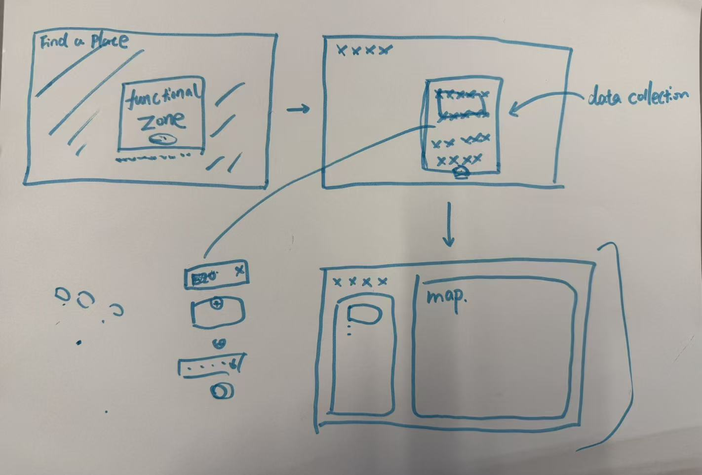
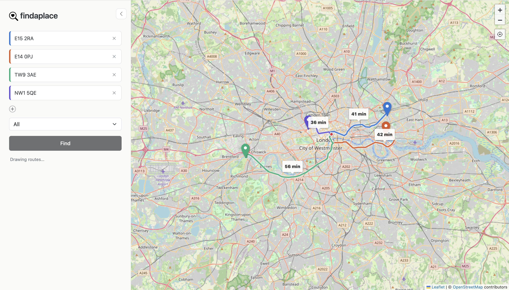
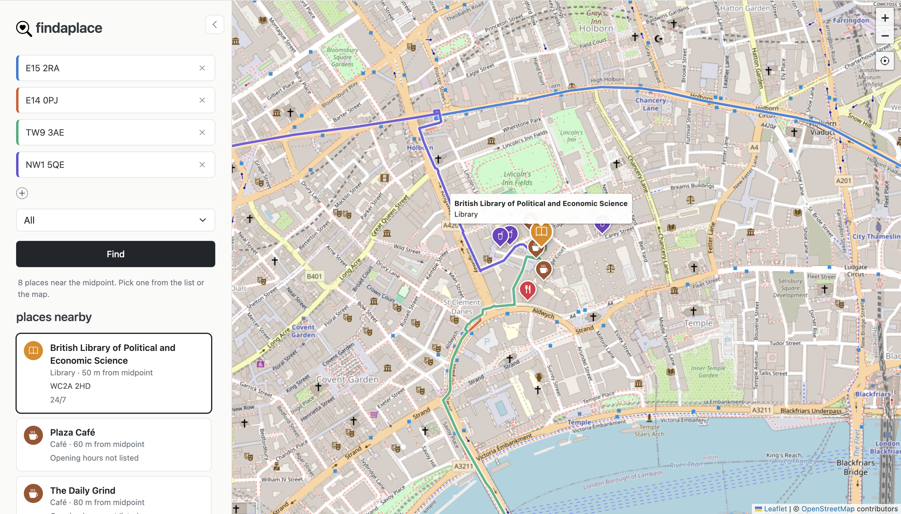
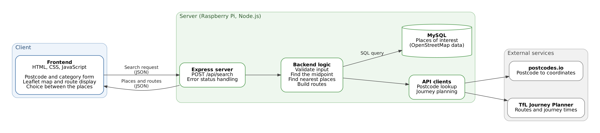
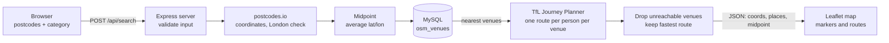

<!---

---
title: "CASA0017: Web Architecture Final Assessment"
author: "Steven Gray, Valerio Signorelli, Duncan Wilson, Sarah Wise"
date: "10 Dec 2020"
---

-->

# Find a Place

Team Name: Chinese can fly  
Team authors: Qingshan Zhang, Anthony Xie, Monong Yang, Jinhao Zhong

## *Abstract*

*“Find a Place” is a website that helps a group of people living in different parts of London decide where to meet. Users enter between two and six postcodes and choose a venue type. The site locates the midpoint of the group and selects nearby venues from a database built on OpenStreetMap. It then uses the Transport for London Unified API to plan each person's journey. Any venue that someone cannot reach is removed. The frontend and the Node.js backend were developed separately, then integrated and refined. The result is a simple, map-based tool that gives a group a shared starting point for choosing a place. Future work would rank venues by travel time instead of distance, making the suggestions fairer.*


## 1. Introduction

### 1.1 Background and Problem

People who study or work together in London often live far apart. For example, the four members of our group live in different areas of the city, and whenever we want to meet up off campus, we run into the same small but persistent question of where to go. Each of us is familiar with the area near where we live but knows little about somewhere we do not visit often. Hence, it is hard to judge whether a suggestion suits everyone. In practice the choice is often made by whoever speaks first, and someone else ends up with a much longer journey. This everyday experience reflects a wider finding in transport research. Public transport accessibility in London is unevenly distributed. It is highest in the centre and along the main radial corridors, and lower elsewhere (Nie et al., 2024). The same destination can therefore be easy to reach for one person and difficult for another.

Two existing products shaped our thinking. Google Maps and Apple Maps are widely used journey planners, and during development we treated both as models of good design, with a map that fills the screen, a simple search panel, and clear routes drawn on the map (Google, 2026; Apple, 2026). However, both are built around one person travelling to a place that has already been chosen. They do not suggest a place for a group.

This gap led to the idea behind Find a Place, a website that takes each person's starting point and suggests a suitable place to meet between them, such as a restaurant, café, library, park or pub. The idea came first and the data came later. Once a consensus on the issue was reached, we began looking for data to substantiate it. We found that the Transport for London (TfL) Unified API provides journey plans across the public transport network (Transport for London, 2026). This made it possible to show each person's real journey, not just a straight-line distance.

### 1.2 Research Topic and Aims

The research topic of this project is how a group of people living in different parts of London can find a place to meet that sits between all of them and that every member can realistically reach. It asks a simple question: Given where everyone is starting from, where is a sensible place to meet, and how would each person get there?

The website has three aims. Firstly, it should find a meeting place in the middle of the group. It does this by locating the midpoint of everyone's starting points, selecting real venues close to it, and checking that every member can reach them. Secondly, the interface should be clean, clear and easy to understand. Find a Place is a practical tool, so the design avoids decoration that does not help the user complete the task. Thirdly, the site should be carefully built in its details and coherent as a whole. For instance, in how it responds to an invalid postcode or shows that results are loading.

The following sections explain how these aims were met, in the order the site was built, integrated and refined.

## 2. Data and Database

### 2.1 Data Sources

Find a Place draws on three open data sources (Table 1). Candidate meeting places come from OpenStreetMap (OSM) (OpenStreetMap contributors, 2026), extracted through the Overpass API (overpass-turbo.eu, n.d.) for Greater London in five categories: restaurants, cafés, pubs and libraries (OSM `amenity` tag) and parks (`leisure` tag). The postcode each person enters is converted to coordinates with postcodes.io (postcodes.io, n.d.), and their journey from that origin to a candidate venue is obtained from the Transport for London (TfL) Unified API (Transport for London, 2026), which returns the public transport route and its duration. OSM was preferred to commercial services such as Google Places because it is free, has no per-request charge, and its open licence allows the project to keep a complete local copy of the venues.

| Source | What it provides | Used for | Licence | Link |
| --- | --- | --- | --- | --- |
| OpenStreetMap via Overpass API | Venue name, category, location; optional cuisine, opening hours, website and address | Candidate meeting places | ODbL, © OpenStreetMap contributors | https://overpass-turbo.eu |
| TfL Unified API | Journey route for each person, including duration | Travel time calculation and route display | Powered by TfL Open Data | https://api.tfl.gov.uk |
| postcodes.io | Latitude, longitude and region for each UK postcode | Locating each person's origin and checking it is in London | Open Government Licence (ONS Postcode Directory) | https://postcodes.io |

*Table 1: Data sources used in Find a Place.*

### 2.2 Collection and Cleaning

Venues were collected once and stored in MySQL, because they change slowly and querying Overpass on every search would be slow and exposed to rate limits. Journeys, by contrast, depend on each group's origins and cannot be prepared in advance, so the backend requests one route per person from TfL at search time.

The Overpass query used `out center`, reducing building and park polygons to a single centre point, and kept only named elements, which removed 1,741 unnamed places and 20 untagged ones. The tab-separated export was imported with `LOAD DATA LOCAL INFILE`, with `NULLIF` converting empty strings to NULL. Remaining problems were fixed in SQL: rows with mixed tags (such as a cemetery also tagged as a park) were deleted if their category fell outside the five, single-character names were removed, duplicate IDs were rejected by the primary key, and two venues whose opening hours contained line breaks were repaired. The final table holds 21,114 venues: about 8,960 restaurants, 6,650 cafés, 3,140 pubs, 1,960 parks and 395 libraries.

OSM is crowdsourced and uneven: in the raw export only 59.2% of features had a postcode and 23.8% had opening hours. Rather than discard these venues, the site keeps them and shows "Opening hours not listed" on the venue card.

### 2.3 Database Design

The `findaplace` database runs on MySQL 8.4 with the utf8mb4 character set, so venue names in any script are stored correctly. Its core table, `osm_venues` (Table 2), holds one row per venue: coordinates, name, category, optional descriptive tags and a `fetched_at` timestamp that defaults to the time the row was imported. The OSM `amenity` and `leisure` tags were merged into a single `category` column holding one of five values (`restaurant`, `cafe`, `pub`, `park`, `library`), so the backend can filter any venue type with one condition.

The primary key is the pair `(osm_type, osm_id)` rather than `osm_id` alone, because OSM numbers nodes and ways independently and one ID can refer to two different objects. The backend finds candidates with a bounding-box query covering about 3 km around the group's midpoint, then orders them by distance; narrow the search by latitude without scanning all rows without scanning all 21,114 rows. Free-text tags such as opening hours and website use `VARCHAR(255)`, OSM's maximum tag length, while fields with predictable lengths, such as postcode and street, use shorter columns.

The backend connects through Node.js `mysql2` with a dedicated account, `findaplace_app`, limited to SELECT, INSERT, UPDATE and DELETE. Credentials stay in an `.env` file excluded from GitHub, and every query is parameterised to prevent SQL injection.

| Key | Column | Type | Null | Default |
| --- | --- | --- | --- | --- |
| PK | `osm_type` | VARCHAR(10) | NOT NULL | |
| PK | `osm_id` | BIGINT | NOT NULL | |
| IDX | `lat` | DOUBLE | NOT NULL | |
| IDX | `lon` | DOUBLE | NOT NULL | |
| | `name` | VARCHAR(150) | NOT NULL | |
| | `category` | VARCHAR(100) | NULL | NULL |
| | `cuisine` | VARCHAR(255) | NULL | NULL |
| | `opening_hours` | VARCHAR(255) | NULL | NULL |
| | `website` | VARCHAR(255) | NULL | NULL |
| | `street` | VARCHAR(100) | NULL | NULL |
| | `postcode` | VARCHAR(15) | NULL | NULL |
| | `fetched_at` | DATETIME | NULL | CURRENT_TIMESTAMP |

Indexes: `PRIMARY KEY (osm_type, osm_id)`; `INDEX idx_lat_lon (lat, lon)`. Engine: InnoDB, character set utf8mb4 (`utf8mb4_unicode_ci`).

*Table 2: Structure of the `osm_venues` table.*


## 3. Design and User Experience

### 3.1 User Journey and Storyboard

We designed Find a Place as a practical tool, making clarity, speed and ease of use our priorities. Users should understand its purpose and get a result without instructions or an account.

The journey begins with a short slogan on the map explaining the service. Users collect their group's postcodes, enter between two and six, choose a venue category and press Find. Suggested venues and routes then appear on the map. Users compare the options, select a venue and note its name and address to share with the group.

We removed registration because accounts are unnecessary for this task. We use UK postcodes rather than free-text addresses because they are a familiar location reference in our London-focused context. The six-person limit keeps the process manageable; larger groups can search in smaller subgroups. We do not ask users to choose a transport mode because journey times are comparative references, not live travel guarantees. Recognisable icons and short labels also reduce reliance on written instructions.


### 3.2 From Wireframes to Final Interface

The design evolved from an initial three-page concept into a single-page interface. This was our most significant design change. Moving between pages would add steps and require users to remember information. We therefore brought postcode inputs, search controls and map results together, allowing the main task to be completed in one place.

We also simplified the visual language and reduced the number of decisions. In the final version, users enter postcodes, choose a venue category and press Find. We removed the proposed transport-mode selector because it added complexity without being essential to our intended comparison. We also retained a familiar map appearance instead of applying a heavily customised style, so users can recognise standard map symbols, routes and spatial relationships.

The map is the main results area. Before a search, a short slogan uses the otherwise empty map space to explain the website; it disappears once users begin. This gives first-time visitors context without taking up space during the task. Overall, the final interface is more direct and focused than the original wireframe.

| Initial Wireframe | Final Interface |
|:---:|:---:|
|  |  |

*Figure 1: Comparison between the initial wireframe (left) and final interface (right).*


### 3.3 Visual Design Decisions

Our visual design takes inspiration from familiar mapping services, particularly Apple Maps and Google Maps. A minimal colour palette, clear typography and straightforward layout keep attention on the map. We avoided heavily styling the map because users should recognise it immediately and understand its symbols and routes.

The frontend uses standard HTML, CSS and JavaScript rather than a large framework. Leaflet provides the interactive map, while custom CSS controls the layout and appearance. Recognisable icons chosen from Bootstrap Icons (Bootstrap, n.d) communicate venue categories and actions quickly, reducing reliance on lengthy text. The logo follows the same simple visual language.

We also made a basic mobile adaptation. On narrower screens, the map appears above the control panel, so users can see geographical results first and access the inputs below.

## 4. Interactivity and Visualisation

### 4.1 Functional Logic and User Inputs

Find a Place follows an input–process–result flow. Users enter two to six UK postcodes, select a venue category and press Find. The backend validates the postcodes, obtains their coordinates and calculates the group's geographical midpoint. It then searches the local venue database for nearby places and requests TfL journeys from each participant to each candidate.

A loading state appears while the search runs. The map then displays available venues and routes. Venues that cannot be reached by every participant are excluded. For each remaining venue, the fastest journey returned for each person provides a travel-time reference. Users can inspect alternatives by selecting a map marker or its matching item in the side panel.

We deliberately limit the choices: there is no account, free-text address field, departure-time setting or transport-mode selector. The website is intended for advance planning, so journey times are indicative rather than real-time guarantees. The task therefore remains simple: enter postcodes, choose a category and search.


### 4.2 Map and Result Visualisation

The map is the main area for exploring results. Each suggested venue has a marker, and routes to the selected venue are drawn on the map. Users can therefore see the geographical relationship between the group and each option in one view.

Small interactive effects make the map easier to explore. When the pointer moves over a venue marker, it enlarges and displays the venue name. Users can select a venue either on the map or from its item in the side panel, supporting both spatial and list-based interaction. Hovering over a route reveals the relevant travel time.

After a search, travel-time information appears briefly (around two seconds) and then fades. This provides an initial comparison without crowding the map with labels. It also encourages users to move the pointer over individual routes to inspect further details.

Together, these cues help users compare journey times and understand how accessible each venue may be for different participants. The map does not claim that a result is perfectly fair; it makes location and journey information easier to compare.


*Figure 2: Result view showing the suggested venue and each participant's travel route and journey time.*

## 5. Backend and API

### 5.1 System Architecture

Figure 3 shows the system architecture of Find a Place and how a search request moves between its components.


*Figure 3: System architecture of Find a Place*

### 5.2 Server Setup

The server is a Node.js application using Express.

The following command installs the dependencies:

```bash
npm install express mysql2 dotenv
```

The following command starts the server:

```bash
npm start 
```

### 5.3 Backend Implementation

Table 3 lists the API endpoint and Table 4 summarises the backend functions described below.

| Endpoint | Method | Parameters | Returns |
| --- | --- | --- | --- |
| `/api/search` | POST | `postcodes`, `category` | `coords`, `places`, `midpoint` |

Table 3: API endpoints

| Function | File | Description |
| --- | --- | --- |
| `parseInput` | `backend.js` | Validates the user's input |
| `getGeoCode` | `api.js` | Lookup postcodes through postcodes.io |
| `findMidPoint` | `backend.js` | Calculates the average of everyone's lat/lon |
| `findNearestPlaces` | `backend.js` | Queries MySQL for POIs nearest to the midpoint |
| `routes` | `backend.js` | Gets each person's journey through TfL |
| `getJourneyPlan` | `api.js` | Calls the TfL Journey Planner API |

Table 4: Backend functions

The frontend collects the user’s postcodes and the chosen venue category and packages them into a JSON object that is sent in a POST request to the `/api/search` endpoint. The Express server receives the request and the `express.json()` middleware parses the body. The body is passed into the `parseInput` function in `backend.js`, which ensures that the inputs are formatted correctly, i.e. that none of the postcode fields are left empty and that the category selected is a valid one. 

Once parsed, the postcodes are then passed into the `getGeoCode` function in `api.js`. This function calls the postcodes.io API and sends it the postcodes in a JSON object. The postcodes.io API returns a JSON object that contains the latitudes and longitudes for each postcode. If some postcodes could not be identified or are situated outside of London, the function throws an error. The `getGeoCode` function returns an array of objects that contains the postcodes and their corresponding latitudes and longitudes.

The geometrical midpoint is found by calculating the average of the latitudes and longitudes. This midpoint and the category are then used to query the MySQL database of all the places of interest in London. The `findNearestPlaces` function queries for the POIs of the corresponding category and ranks them based on their Euclidean distance from the midpoint and chooses the 3 POIs nearest to the midpoint (or 8 if the category selected is “all”). The function returns the details of the chosen POIs.

For each chosen POI, the `routes` function in `backend.js` passes the coordinates of the POI in the {to} parameter and passes the coordinates of each person in the {from} parameter to a TfL Journey Planner API call in the `getJourneyPlan` function in `api.js`. The TfL API key is stored in an `.env` file that is never shared to the frontend. The `getJourneyPlan` function throws an error if the server is missing a TfL API key, if the request times out (15 second timeout) or if the request fails. If TfL reports that no route exists between a person and a POI, the `getJourneyPlan` function returns `null`, which means `routes` returns `null`, resulting in the `search` function ignoring that POI. An error isn't thrown here since other POIs can still be suitable and throwing an error would break the loop and not return anything. For each remaining POI, the TfL API returns several possible journeys for each person, the fastest one is selected and only the relevant information is kept. 

The `search` function is the function called by the POST request from the frontend and it returns `coords` (an array of objects containing each person's postcode and lat/lon), `places` (an array with one object per POI), and the `midpoint`. Each object in `places` contains the information of the POIs the frontend needs, the name, postcode, category, lat, lon, opening hours, and the output of the `routes` function which contains the travel time, departure time, arrival time and the legs for each person's journey. The frontend displays the POI nearest to the midpoint by default and switches the displayed routes when the user selects another POI.


## 6. Integration and Iteration

### 6.1 Data Flow

Figure 4 traces one search through the system; the functions involved are described in Section 5.2. The browser sends the group's postcodes and chosen category to `/api/search` as JSON. The Express server validates the input and passes the postcodes to postcodes.io, which returns their coordinates and confirms that each lies in London. The backend averages these into a midpoint, queries `osm_venues` for the nearest venues of that category, and requests a TfL journey from every person to every candidate. Venues that someone cannot reach are dropped, and the rest return to the browser with each person's fastest route, ready to be drawn on the map.



*Figure 4: Data flow.*

### 6.2 Integrating Frontend and Backend

The frontend and backend were developed in parallel, and each made its own assumptions. The frontend prototype worked entirely in the browser. It geocoded postcodes with postcodes.io, fetched venues live from three Overpass API mirrors and drew driving routes from the public OSRM server. The backend was written as a set of ES-module functions around MySQL and TfL, but no HTTP route called them, and the existing server, a plain Node `http` static file server, rejected every request except GET with a 405 error.

Integration therefore moved every external call to the server. `server.js` was rewritten in Express to serve the frontend as static files and expose a single `POST /api/search` endpoint, which returns errors as JSON with a matching status code. A root `package.json` added the dependencies and an `npm start` script. In `scripts.js`, over 200 lines of API code were replaced by one `fetch` to this endpoint, so the browser contacts no third-party service, the TfL key stays on the server, and routes follow public transport rather than roads. A category menu was added whose values match the list the backend accepts.

Agreeing the response format (Section 5.2) exposed several mismatches. The SQL selected `type` and `id`, which do not exist in `osm_venues`, causing 500 errors; the frontend read `pois` and `leg.path`, while the backend sent `places` and no route geometry; and the midpoint, needed to start the map animation, was not returned. The backend now returns the midpoint and converts each TfL leg's `lineString`, a JSON string of [lat, lon] pairs, into a `pathLine` array that Leaflet draws without conversion.


### 6.3 Adjustments and User Testing

Testing after integration exposed problems on both sides (Table 5). On the backend, the original server rejected POST requests with a 405 error, so it was rebuilt on Express, and searches in the "All" category returned too few venues, so the result limit was raised to eight in that case. Most remaining changes concerned the map. Routes and the midpoint marker swelled during zoom animations until a custom SVG renderer was written to redraw them on every frame, and some route animations ended instantly or crashed until every line was given the same 2.5-second duration and a divide-by-zero in the animation plugin was guarded. On narrow screens the map attribution was hidden behind the panel, and after a search the top result was not highlighted, so it is now selected automatically. 
| Issue found | Side | Change made |
| --- | --- | --- |
| POST requests rejected with 405 | Backend | Rewrote the server with Express |
| "All" returned too few places | Backend | Result limit raised to 8 when "All" is selected |
| Routes and midpoint marker grew during zoom animations | Frontend | Custom SVG renderer that redraws on every zoom frame |
| Some route animations finished instantly or crashed | Frontend | Same 2.5 s duration for every line; divide-by-zero guarded in the animation plugin |
| Map attribution hidden behind the panel on narrow screens | Frontend | Removed the fixed map minimum height on small screens |
| Top result not highlighted after a search | Frontend | First place selected automatically |

*Table 5: Issues found during integration and testing, and the changes made.*


## 7. Conclusion

### 7.1 Evaluation

Find a Place met its three aims to different degrees. The first was met in a basic form. The site finds the midpoint of a group, suggests real venues near it and removes any that a member cannot reach by public transport. The second was met. The interface is a single page with a full-screen map and a short input panel, and a group gets a result in a few steps. The third was largely met, with clear messages for invalid postcodes and a visible loading state.

### 7.2 Limitations

The main limitation is the midpoint itself. A geometric midpoint is not always the fairest point to travel to, for example when a group is split by the river or served by uneven transport lines. Venues are searched only within 3 km of the midpoint and ranked by straight-line distance, not by travel time. Each search calls the TfL API once per person per venue, up to 48 times, which is slow. The site covers only London, and only public transport and walking. Opening hours are stored but not used to filter results, and the OpenStreetMap venue data is a one-off snapshot of uneven completeness.

### 7.3 Future Work

With more time, the top priority would be the algorithm. Venues could be ranked by travel time, by minimising either the longest journey in the group or the difference between journeys, which would bring the site closer to a fair result. Ratings for each place could also be included in the ranking, helping the site recommend places that are both convenient to reach and highly rated. TfL results could be cached to speed up searches, and each person's travel time could be shown on the venue cards. Users could also choose a departure time and travel mode. A place name search could be added alongside postcode entry to enhance the user experience. The venue data could be refreshed regularly. The interface is already simple, so new features would be added only where they are clearly needed. If the site works well, it could be extended from London to the rest of the UK.


## Bibliography

1. Apple (2026). Apple Maps. <https://www.apple.com/maps/> [Accessed 13 Nov. 2026].

2. Google (2026). Google Maps. <https://www.google.com/maps> [Accessed 13 Nov. 2026].

3. Nie, Y., Bhatnagar, S., Smith, D. and Suel, E. (2024). Disparities in public transport accessibility in London from 2011 to 2021. *Computers, Environment and Urban Systems*, 113, 102169. <https://doi.org/10.1016/j.compenvurbsys.2024.102169>

4. Transport for London (2026). Unified API. <https://tfl.gov.uk/info-for/open-data-users/unified-api> [Accessed 13 Nov. 2026].

5. postcodes.io. (n.d.). *Postcodes.Io*. [online] Available at: https://postcodes.io/ [Accessed 5 Nov. 2026].

6. Transport For London - API. (2024). *Home*. [online] Transport for London - API. Available at: https://api-portal.tfl.gov.uk/ [Accessed 5 Nov. 2026].

7. overpass-turbo.eu. (n.d.). *Overpass Turbo*. [online] Available at: https://overpass-turbo.eu/ [Accessed 5 Nov. 2026].

8. OpenStreetMap contributors (2026). OpenStreetMap. Available at: https://www.openstreetmap.org [Accessed 15 Nov. 2026]

9. Bootstrap (n.d.). Bootstrap icons. [online] icons.getbootstrap.com. Available at: https://icons.getbootstrap.com/ [Accessed 15 Nov. 2026].
   
----

## Declaration of Authorship

We, Qingshan Zhang, Anthony Xie, Monong Yang, Jinhao Zhong, confirm that the work presented in this assessment is our own. Where information has been derived from other sources, I confirm that this has been indicated in the work.


Digitally Sign with Your name Here: Anthony Xie, Monong Yang


ASSESSMENT DATE 13 Nov 2026

## Declaration of Generative AI Use

We acknowledge the use of ChatGPT (OpenAI, https://chatgpt.com) and Claude (Anthropic, https://claude.ai) as supporting tools during this project. These tools were used to assist with understanding technical concepts, code development and debugging, and improving the clarity and language of written content. AI-generated suggestions were reviewed and adapted by the team, and we take full responsibility for the final submitted work.
