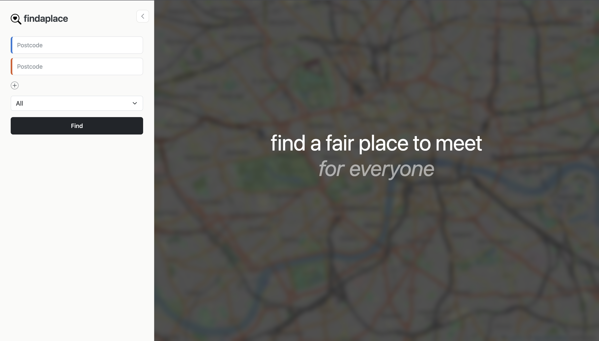

# Find a Place

**Find a fair place to meet for everyone.**

Find a Place is a web application designed to help groups find a convenient and fair meeting location. By considering where each participant is travelling from, the website helps identify suitable places that make meeting up easier and more balanced for everyone.

Our aim is to reduce the difficulty of coordinating group meetups and make location decisions more accessible, efficient and fair.

（This is the Final assessment template for CASA0017 - Please use this template and edit the relevant sections to personalise.
This section has a short introduction to what the website is about and what research problem the site is solving.  Remeber this file showcases your website source code so use it to sell what you can do as a group or showcase in a future portfolio. ）

## Website Demo

（Use this section to show us what your Website is about.   Include a Screenshot to the Website in this README file, link to the various frameworks you've used.  If you want to show off your website you can add a Gif of you interacting with your site.   Emojis are also fun to include as well 😄

Look at some other Websites online in GitHub and see how they use the README File to showcase thier site.  Good examples are:

- https://github.com/smaranjitghose/awesome-portfolio-websites
- https://github.com/gohugoio/hugo    
- https://github.com/academicpages/academicpages.github.io
）

##  Replace the Tags on the side menu of GitHub

Put some tags in to make your site more searchable in GitHub

## Include A Section That Tells Developers How To Install The App

Include a section that gives intructions on how to install the app or run it in Docker.  What versions of the plugins are you assuming?  Maybe define a licence as well, this is good practise.

##  Contact Details

Having Contact Details is also good as it shows people how to get in contact with you if they'd like to contribute to the app. 

##  Our Website  
The website is deployed on a Raspberry Pi and can be accessed through the following address when connected to the accessible network:
http://10.129.111.26:3001

## Our Valuable Contributors 👩‍💻👨‍💻

