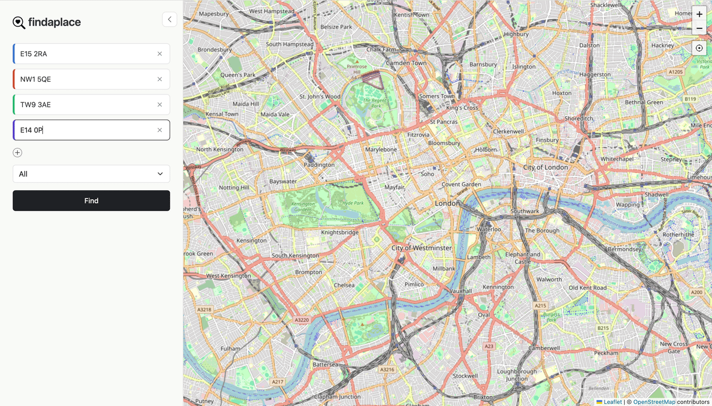

# Find a Place

**Find a fair place to meet for everyone.**

Find a Place is a web application designed to help groups find a convenient and fair meeting location. By considering where each participant is travelling from, the website helps identify suitable places that make meeting up easier and more balanced for everyone.

Our aim is to reduce the difficulty of coordinating group meetups and make location decisions more accessible, efficient and fair.


## Website Demo


*Example usage of the website.*

## Website Setup

### Environment variables

Copy `.env.example` to `.env` and fill in your values:

| Variable | Description |
| --- | --- |
| `DB_HOST` | MySQL host, e.g. `localhost` |
| `DB_USER` | MySQL user |
| `DB_PASSWORD` | MySQL password |
| `DB_NAME` | Name of the database |
| `TFL_API_KEY` | Your TfL API key |

### Install dependencies

```bash
npm install express mysql2 dotenv
```

### Running the server

```bash
npm start
```

Then open http://localhost:3001 in your browser.


##  Contact Details

Anthony Xie: zcabaxi@ucl.ac.uk

Jinhao Zhong: zczvj18@ucl.ac.uk

Monong Yang: ucfnmy2@ucl.ac.uk

Qingshang Zhang: zczvqz2@ucl.ac.uk

##  Our Website
The website is deployed on a Raspberry Pi and can be accessed through the following address when connected to the accessible network:
http://10.129.111.26:3001


## Our Valuable Contributors 👩‍💻👨‍💻

<a href="https://github.com/anthony-xie/casa0017-web-assessment/graphs/contributors">
  
</a>
